```text
; ======= S U B R O U T I N E ========
; Attributes: bp-based frame
;
; Hardware identity for virtual
; machines on NixOS. A KVM/QEMU guest
; that cannot be told apart from bare
; metal, not by hiding signs of a VM
; but by reporting the real identity
; of a specific machine. Declarative,
; all of it in Nix.
;
; ======== R E G I S T E R S =========
; RIP 987dca0c38a90fd8 ; alyxcial
; RAX 0000000000000005 ; public repos
; RCX 0000000000000013 ; 2026 commits
; RDX 0000000020261102 ; last commit

section .text

alyxcial proc near
    push  rbp
    mov   rbp, rsp

read_the_source:
; Firmware and drivers, reversed to
; find out what detection really reads.
; - raw SMBIOS and ACPI, not dmidecode,
;   which drops enum bytes
; - QEMU, OVMF/EDK2 and KVM at source
;   and patch level
; - custom Linux trees, KVM on AMD
;   (SVM), scheduling and timing paths
; - Windows: dxgkrnl, amdkmdag, DMUB
;   firmware, offline registry hives
; - VMAware and my own oracle, read in
;   source to learn what each technique
;   measures

projects:
; memory.wtf: my own NixOS-based OS
; with a fully custom, patched kernel.

method:
; Measure, don't guess. Source tells
; you which paths exist, not which one
; this board uses. The answer is a
; diagnostic that looks for the data,
; not for a register.
;
; A fix has to be proven: mutation
; test, readback, measured effect. A
; green build proves nothing.
;
; Green test, dead code is a real
; trap. The test has to replay the
; driver's sequence from source, not
; the one you imagine.
;
; Silent no-ops are caught by guards
; on bytes, not on intent.

principle:
; No workarounds, only root causes.
; "Works on HDMI, not on DP" gets
; traced down to the driver macro that
; expands into three register writes.

    int   3          ; Trap to Debugger
    lea   rdi, [rel blob]
    mov   esi, BLOB_LEN
    mov   dl, [rel seed]
    call  decode
    leave
    ret
alyxcial endp

; ======= S U B R O U T I N E ========
; rdi = buf, rsi = len, dl = seed
decode proc near
    xor   ecx, ecx
.next:
    cmp   rcx, rsi
    jae   .done
    xor   [rdi+rcx], dl
    rol   dl, 3
    add   dl, cl
    inc   rcx
    jmp   .next
.done:
    ret
decode endp

section .rodata

aTools  db "C++, x86-64 assembly,"
        db " C, Go",10
        db "IDA, Ghidra, Linux,"
        db " NixOS, QEMU",0

section .data

seed    db ?         ; not stored here
blob:
        dq 0x0E5F715BC4550AAA
        dq 0x4787DE8A369D43F2
        dq 0xA59C4DF16BF8B64D
        dq 0xE96C8B58E35BE61D
        dq 0x5A68EFCE1C9F4A50
        dq 0xB7F178F38EF489F4
        dq 0x9366EC5C6E16E31C
BLOB_LEN equ $-blob
```

<!-- seed: the byte a debugger writes over your instruction -->
